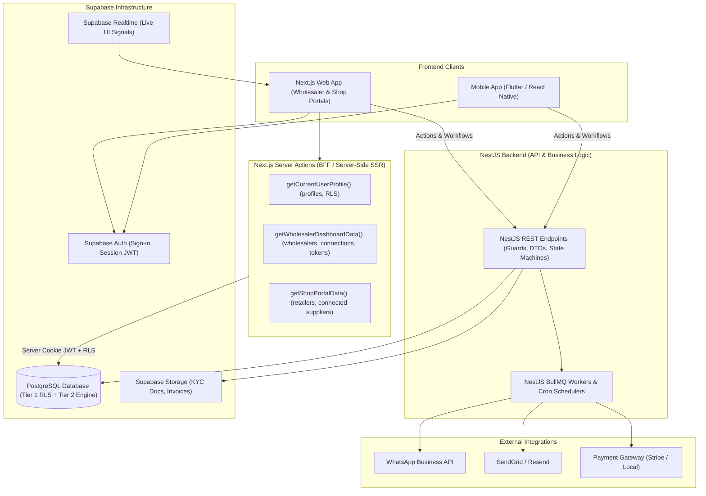
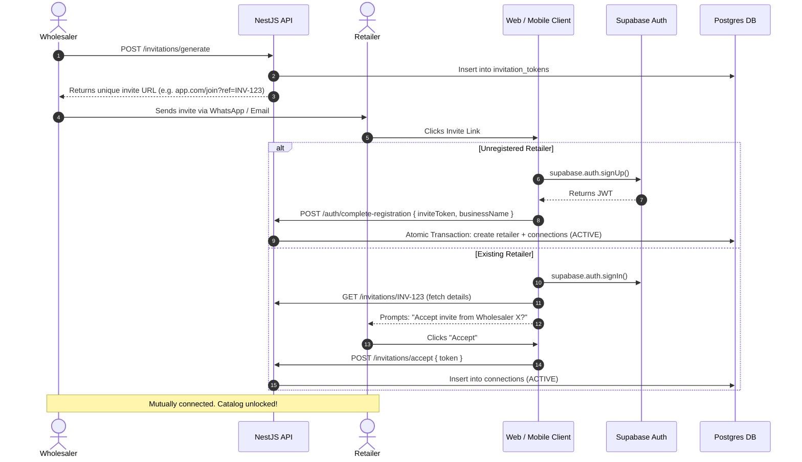
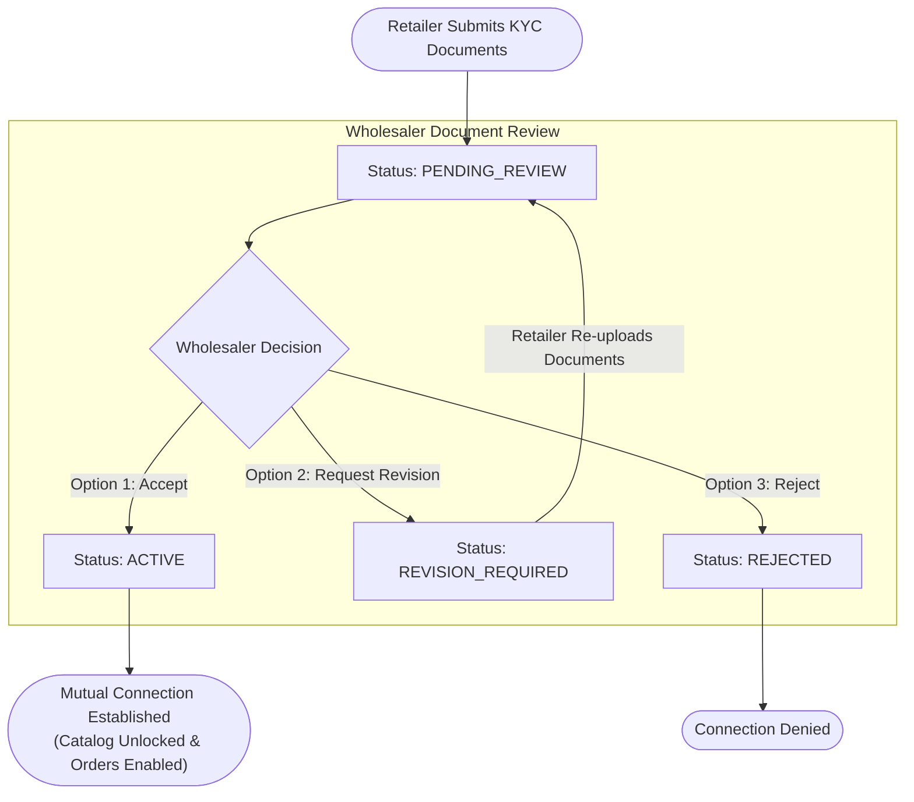

# B2B Wholesale Platform — Architecture & Implementation Blueprint

This document defines the complete architectural blueprint and division of responsibilities for the B2B Wholesale Marketplace platform across **Supabase**, **NestJS**, and the **Client Applications (Next.js Web & Mobile Apps)**.

---

## 1. High-Level Architecture: The Hybrid Pattern

The platform uses a **Hybrid Architecture**:

- **Supabase** acts as the **Infrastructure & Data Layer** _(The Vault)_: Identity authentication, private file storage buckets, managed PostgreSQL, and live WebSocket broadcasts.
- **Next.js Server Layer (BFF via Server Actions & Server Components)**: Securely executes user-scoped reads (`getCurrentUserProfile`, `getWholesalerDashboardData`, `getShopPortalData`) using the Supabase Server Client (`@supabase/ssr`) and HTTP-only cookies, strictly enforced by PostgreSQL Row Level Security (RLS). The browser never calls PostgREST directly.
- **NestJS** acts as the **Application & Business Engine** _(The Brain)_: Complex transactional workflows, multi-step state machines (PO -> Counter-Offer -> Invoice -> Settlement), atomic stock reservations, PDF generation, background task queues, and connection-gated catalog sanitization (stripping `cost_price`).
- **Next.js & Mobile (Flutter / React Native)** act as **Clients**: Consuming the backend API for business workflows and state transitions, and leveraging server-side rendered views for user dashboards.



---

## 2. Master Responsibility Matrix (By Domain, Actor & CRUD Operations)

This matrix defines the distribution of responsibilities across the three architectural tiers:
- **Next.js Web / BFF**: React Server Components (RSC) and Server Actions using `@supabase/ssr` with the user's session cookie.
- **NestJS Application Engine**: Transactional state machines, inventory locks, background workers (BullMQ), and audit trails.
- **Supabase Platform**: PostgreSQL database (with RLS), GoTrue authentication, private S3 storage, and WebSocket realtime signals.

Actors:
- **RETAILER**: Buyer persona searching suppliers, browsing catalogs, submitting POs, and managing shop profiles.
- **WHOLESALER**: Seller persona maintaining inventory, issuing counter-offers, reviewing retailer KYC, and shipping orders.
- **BOTH**: Actions performed symmetrically by both trading partners (scoped to their own orders/connections).
- **ADMIN**: Platform operational staff (Sub-roles: `SUPER_ADMIN`, `COMPLIANCE`, `SUPPORT`, `FINANCE`).
- **GUEST / ALL**: Unauthenticated visitors or shared base capabilities across all authenticated users.

---

### Domain 1: Product Catalog & Inventory Management

| Feature / Task | Actor / Role | CRUD | Handled By | Mechanism (HOW) | Architectural Rationale (WHY) |
| :--- | :---: | :---: | :--- | :--- | :--- |
| **Browse Catalog** | **RETAILER** | **READ** | **Next.js + Supabase** | Server Component queries `public.products` via `@supabase/ssr` using explicit column projection (`id, name, sku, wholesale_price, stock_quantity, images, min_order_quantity`). | **Sub-10ms Page Loads**: Fast streaming SSR without API proxy overhead. **Margin Protection**: Explicit column projection strictly omits `cost_price` (wholesaler profit margin) from client HTML/JSON. |
| **View Own Inventory** | **WHOLESALER** | **READ** | **Next.js + Supabase** | Server Component queries `public.products` via `@supabase/ssr` with RLS (`wholesaler_id = auth.uid()`). Returns all columns including `cost_price` and `reserved_quantity`. | **Owner-Only Isolation**: Database RLS ensures wholesalers only view their own stock and margins. Instant warehouse dashboard rendering. |
| **Add New Product** | **WHOLESALER** | **CREATE** | **Next.js + NestJS + Supabase** | Wholesaler submits form -> NestJS `POST /products` (validates DTO, unique SKU per supplier, category ID, and image URLs) -> inserts row into `public.products`. | **Data Sanitization & Integrity**: NestJS validates commercial constraints (`wholesale_price > 0`, non-negative stock, valid SKU format) before database write. |
| **Update Product Details** | **WHOLESALER** | **UPDATE** | **Next.js + NestJS + Supabase** | Wholesaler edits SKU -> NestJS `PUT /products/:id` (verifies ownership, validates price/stock changes) -> updates `public.products`. | **Validation & State Protection**: NestJS verifies ownership and ensures price or MOQ changes do not corrupt active pending purchase order negotiations. |
| **Reserve / Deduct Stock during Checkout** | **SYSTEM / NESTJS** | **UPDATE** | **NestJS + Supabase** | NestJS executes inside an atomic PostgreSQL transaction: `SELECT stock_quantity, reserved_quantity FROM products WHERE id = ... FOR UPDATE`. Increments `reserved_quantity`. | **ACID Concurrency Safety**: Prevents race conditions and double-selling when multiple retailers order the last remaining units simultaneously. |

---

### Domain 2: Orders, Invoices & Negotiation State Machine

| Feature / Task | Actor / Role | CRUD | Handled By | Mechanism (HOW) | Architectural Rationale (WHY) |
| :--- | :---: | :---: | :--- | :--- | :--- |
| **View Orders List / Queue** | **BOTH** | **READ** | **Next.js + Supabase** | Server Component queries `public.orders` via `@supabase/ssr` with URL query parameters (`?status=...&query=...&date=...`). Enforced by participant RLS (`wholesaler_id = auth.uid() OR retailer_id = auth.uid()`). | **High-Speed Server Filtering**: URL-driven state rendering directly from PostgreSQL without shipping client-side filter logic or large JSON arrays to the browser. |
| **View Order Details** | **BOTH** | **READ** | **Next.js + Supabase** | Server Component executes a single nested join: `.from('orders').select('*, order_items(*), invoices(*)').eq('id', id).single()`. | **Zero Boilerplate**: PostgREST returns the order, child line items, and invoice in a single 2ms round-trip. Participant RLS guarantees neither party can view competitor orders. |
| **Submit Purchase Order (PO)** | **RETAILER** | **CREATE** | **Next.js + NestJS + Supabase** | Retailer submits cart -> NestJS `POST /orders` -> atomic transaction: reserves stock, creates `orders` (`SUBMITTED`) and `order_items`, and queues notification worker. | **Commercial Commitment**: Order creation is an ACID financial transaction requiring stock reservation, validation, and multi-channel alerts. |
| **Issue Counter-Offer / Invoice** | **WHOLESALER** | **UPDATE** | **Next.js + NestJS + Supabase** | Wholesaler adjusts confirmed quantities & delivery fee -> NestJS `POST /orders/:id/issue-invoice` -> recalculates totals, transitions status to `INVOICE_SENT`, and queues WhatsApp alert. | **Multi-Table Atomic Transition**: Recalculates line totals, updates order status, generates invoice record, and alerts retailer in one coordinated action. |
| **Accept or Decline Order** | **RETAILER** | **STATE** | **Next.js + NestJS + Supabase** | Retailer submits decision -> NestJS `POST /orders/:id/accept` or `POST /orders/:id/decline` { declineReason } -> locks order, confirms stock deduction, and triggers PDF generator. | **Business Rule Enforcement**: Enforces mandatory decline reasons, locks accepted orders permanently from edits, and triggers background jobs. |

---

### Domain 3: Directory, Invitations & B2B Connections

| Feature / Task | Actor / Role | CRUD | Handled By | Mechanism (HOW) | Architectural Rationale (WHY) |
| :--- | :---: | :---: | :--- | :--- | :--- |
| **Browse Wholesaler Directory** | **RETAILER** | **READ** | **Next.js + Supabase** | Server Component queries `public.wholesalers` joined with `public.profiles` (`is_verified = TRUE`) via `@supabase/ssr`. | **Fast Supplier Discovery**: Server-rendered directory grid with instant search and category filtering. |
| **Generate Invite Link** | **WHOLESALER** | **CREATE** | **Next.js + NestJS + Supabase** | Wholesaler clicks "Generate Invite" -> NestJS `POST /invitations/generate` -> generates rate-limited cryptographic token and stores in `public.invitation_tokens`. | **Cryptographic Security**: NestJS enforces rate-limiting and generates collision-resistant random tokens. |
| **Lookup / Validate Invite Token** | **GUEST / RETAILER** | **READ** | **Next.js + Supabase** | Registration page queries `public.invitation_tokens` where `token = ... AND is_revoked = FALSE`. | **Guest Onboarding**: RLS policy 8.5 allows public read of unrevoked tokens so the registration form displays the inviting wholesaler's name. |
| **Submit Connection & KYC** | **RETAILER** | **CREATE** | **Next.js + NestJS + Supabase** | Retailer submits connection application with KYC document references -> NestJS inserts `connections` (`PENDING_REVIEW`) and `kyc_documents`. | **Relationship Initialization**: Enforces document presence, initializes the connection state machine, and notifies the supplier. |
| **Review KYC (Approve / Reject / Revise)** | **WHOLESALER** | **UPDATE** | **Next.js + NestJS + Supabase** | Wholesaler reviews -> NestJS `PATCH /connections/:id/review { status, feedback }` -> transitions status, logs `kyc_revision_history`, and unlocks catalog. | **Security Gating**: Strictly gates ordering and private pricing; features remain locked until status is promoted to `ACTIVE`. |

---

### Domain 4: Private Storage (KYC Documents & PDF Invoices)

| Feature / Task | Actor / Role | CRUD | Handled By | Mechanism (HOW) | Architectural Rationale (WHY) |
| :--- | :---: | :---: | :--- | :--- | :--- |
| **Upload KYC Document** | **RETAILER** | **CREATE** | **Next.js + NestJS + Supabase Storage** | Browser requests upload ticket from NestJS -> NestJS validates session and issues 5-minute pre-signed upload URL -> Browser uploads file directly to private bucket `kyc-documents/`. | **Zero Server Bottleneck**: Bypasses NestJS memory and bandwidth; heavy files stream directly to cloud storage. |
| **Generate PDF Invoice** | **SYSTEM / WORKER** | **CREATE** | **NestJS Worker + Supabase Storage** | BullMQ background worker triggers upon order acceptance -> renders PDF (Puppeteer/PDFKit) -> uploads buffer to private bucket `invoices/` -> writes `invoices.pdf_storage_path`. | **Decoupled Computing**: Keeps CPU-intensive PDF rendering in background workers to prevent web server latency spikes. |
| **Download / View Private Document** | **BOTH** | **READ** | **Next.js + NestJS + Supabase Storage** | User clicks view/download -> NestJS verifies connection/order ownership -> generates temporary 10-minute expiring signed URL -> browser downloads directly. | **Zero Public Leakage**: Private buckets have no public URLs; expiring signed URLs guarantee strict, auditable access control. |

---

### Domain 5: Identity, Authentication & Profile Self-Service

| Feature / Task | Actor / Role | CRUD | Handled By | Mechanism (HOW) | Architectural Rationale (WHY) |
| :--- | :---: | :---: | :--- | :--- | :--- |
| **Sign-up, Sign-in, Password Reset** | **ALL PERSONAS** | **AUTH** | **Next.js + Supabase Auth** | Client forms call `supabase.auth.signUp()` / `signInWithPassword()`. Database trigger `handle_new_user()` auto-provisions profile. | **Managed GoTrue Auth**: Secure password hashing, JWT session cookies, and atomic database trigger initialization. |
| **Read Own Profile / Portal Data** | **ALL PERSONAS** | **READ** | **Next.js + Supabase** | Next.js Server Component queries `public.profiles` (`auth.uid() = id`) via `@supabase/ssr`. | **Instant Shell Rendering**: User identity and role data injected directly into layouts during SSR. |
| **Update Own Profile & Business Details** | **ALL PERSONAS** | **UPDATE** | **Next.js + Supabase** | Next.js Server Action calls `.from('profiles').update(...)` or `.from('wholesalers').update(...)` with `auth.uid() = id`. | **Lean Self-Service**: Simple profile edits (phone, warehouse address, trade license text) are handled directly via Tier 1 RLS without backend API boilerplate. |

---

### Domain 6: Notifications & Reference Data

| Feature / Task | Actor / Role | CRUD | Handled By | Mechanism (HOW) | Architectural Rationale (WHY) |
| :--- | :---: | :---: | :--- | :--- | :--- |
| **Read Categories & Units of Measure** | **ALL PERSONAS** | **READ** | **Next.js + Supabase** | Server Component queries `public.categories` via `@supabase/ssr` (`USING (TRUE)`). | **Fast Static Lookup**: Categories and reference taxonomies are public and cached; zero backend boilerplate. |
| **Read User Notifications** | **ALL PERSONAS** | **READ** | **Next.js + Supabase** | Server Component / Client queries `public.notifications` (`user_id = auth.uid()`). | **Owner Isolation**: Users securely read and mark their own notifications as read. |
| **Dispatch WhatsApp / Email / In-App Alerts** | **SYSTEM / WORKER** | **CREATE** | **NestJS + BullMQ Workers** | NestJS enqueues notification job upon business events -> BullMQ worker calls WhatsApp Business API / SendGrid -> inserts in-app notification row. | **Reliable Delivery & Retries**: Asynchronous queuing ensures third-party API latency or downtime does not slow down user requests. |

---

### Domain 7: Platform Administration & Back-Office (ADMINS)

| Feature / Task | Actor / Role | CRUD | Handled By | Mechanism (HOW) | Architectural Rationale (WHY) |
| :--- | :---: | :---: | :--- | :--- | :--- |
| **Verify Business Profile** | **ADMIN / COMPLIANCE** | **UPDATE** | **Next.js + NestJS + Supabase** | Admin reviews trade license & TIN -> NestJS `PATCH /admin/verifications/:id` -> sets `profiles.is_verified = TRUE` via Service Role. | **Trust & Credibility**: Only vetted businesses receive directory badges and public discovery rankings. |
| **Suspend / Ban Bad Actor** | **ADMIN / COMPLIANCE** | **UPDATE** | **Next.js + NestJS + Supabase** | Admin suspends fraudulent account -> NestJS calls Supabase Auth Admin API (disables user session) and updates status in database. | **Platform Integrity**: Swift moderation against fraudulent retailers or non-delivering wholesalers. |
| **Audit KYC Submissions & Overrule** | **ADMIN / COMPLIANCE** | **READ / UPDATE** | **Next.js + NestJS + Supabase** | Compliance admin inspects escalated KYC disputes, downloads documents via temporary signed URL, and overrules or flags submissions. | **Regulatory Compliance**: Legal compliance, Anti-Money Laundering (AML) monitoring, and dispute handling. |
| **Order Dispute Mediation & Force Actions** | **ADMIN / SUPPORT** | **READ / UPDATE** | **Next.js + NestJS + Supabase** | Support admin inspects `order_status_history` audit trail and invoices -> can force cancel/refund with mandatory dispute log. | **Conflict Resolution**: Resolves deadlock when a wholesaler fails to ship or a retailer refuses delivery. |
| **Global Category Taxonomy Management** | **ADMIN** | **CREATE / UPDATE / DELETE** | **Next.js + NestJS + Supabase** | Admin manages standard product category hierarchy in `public.categories` via NestJS API. | **Standardized Taxonomy**: Ensures clean, normalized product categorization across diverse suppliers. |
| **Moderate / Delist Flagged Products** | **ADMIN / SUPPORT** | **UPDATE** | **Next.js + NestJS + Supabase** | Admin deactivates prohibited or reported SKUs (`products.is_active = FALSE`) and alerts the supplier. | **Safety & Policy Enforcement**: Protects marketplace from banned, counterfeit, or miscategorized items. |
| **Financial Volume & Net-30 Risk Monitoring** | **ADMIN / FINANCE** | **READ** | **Next.js + Supabase** | Admin dashboard queries aggregate invoice totals, unpaid COD volumes, and overdue Net-30 credit balances. | **Credit Risk Oversight**: Gives finance officers systemic insight into B2B credit exposure and liquidity risk. |
| **Staff Provisioning & RBAC Permissions** | **SUPER_ADMIN** | **CREATE / UPDATE / DELETE** | **Next.js + NestJS + Supabase** | Super Admin invites staff, assigns `admin_role`, and modifies `permissions TEXT[]` in `public.admins` via NestJS Service Role Key. | **Zero Privilege Escalation**: Regular admins have no write access to `public.admins`; all RBAC mutations require Super Admin authentication. |

---
### Rules

1. **Two-Tier RLS Security Model:**
   - **Tier 1 (User-Scoped Self-Service Tables):** `profiles`, `wholesalers`, `retailers`, `connections`, and `invitation_tokens`. Protected by strict user-level RLS policies:
     - `profiles`: `USING (auth.uid() = id)`
     - `wholesalers`: `USING (auth.uid() = id)`
     - `retailers`: `USING (auth.uid() = id)`
     - `connections`: `USING (auth.uid() = wholesaler_id OR auth.uid() = retailer_id)`
     - `invitation_tokens`: `USING (auth.uid() = wholesaler_id)`
     These tables are queried directly on the server by Next.js Server Actions (`getCurrentUserProfile`, `getWholesalerDashboardData`, `getShopPortalData`) using the user's session cookie. The browser never makes direct PostgREST calls.
   - **Tier 2 (Commercial Catalog & Transactional State Machine Tables):** `products`, `orders`, `order_items`, `invoices`, and `kyc_documents`.
     - Direct client PostgREST access is blocked or strictly sanitized via server-side mediation to prevent exposing confidential wholesale margin data (`cost_price`) and ensure concurrency locks during order negotiation.
     - Accessed and mutated exclusively through server-mediated business logic (Next.js Server Actions with explicit column projection, or NestJS backend).
2. **State machines run in DB transactions.** This covers KYC review, counter-offer, and accept/decline, so concurrent actions can't leave an order inconsistent.
3. **Broadcast events carry no data.** They only signal that something changed, and the client refetches from the server.
4. **Realtime channels are private.** One small Realtime authorization policy lets a user subscribe only to their own `user:{id}` channel.
5. **The ORM owns the schema and migrations.** Database migrations maintain both the Tier 1 RLS policies and Tier 2 integrity constraints.

---

## 3. Scenario-by-Scenario Implementation Details

### Scenario 1: Existing Customers & Invite Link Flow



- **Supabase Responsibility**:
  - Authenticates users and manages session tokens.
  - Direct server-side read for catalog browsing once connected with explicit column projection (e.g. `supabase.from('products').select('id, name, wholesale_price, stock_quantity, images')` — `cost_price` is strictly omitted).
- **NestJS Responsibility**:
  - `POST /invitations/generate`: Generates cryptographically secure, rate-limited tokens.
  - `POST /invitations/accept`: Validates token expiration, prevents circular connections, and creates the connection record.
  - `POST /auth/complete-registration`: Handles B2B onboarding questionnaire and links the referrer.

---

### Scenario 2: Discovery, Connection Request & KYC Document Verification



- **Supabase Responsibility**:
  - Hosts private bucket `kyc-documents` (files cannot be accessed via public URLs).
  - Direct REST read for Wholesaler Directory browsing (`supabase.from('wholesalers').select(...)`).
  - Broadcasts live updates via Supabase Realtime when connection status changes.
- **NestJS Responsibility**:
  - `POST /kyc/upload-url`: Validates MIME types (PDF, PNG, JPG), enforces size limits (< 10MB), and calls Supabase Storage SDK to create pre-signed upload URLs.
  - `POST /connections/request`: Records the submission and links document metadata.
  - `GET /connections/requests/:id/documents`: Generates temporary 15-minute signed download URLs for the reviewing wholesaler.
  - `POST /connections/:id/accept`: Transitions status to `ACTIVE`.
  - `POST /connections/:id/request-revision`: Enforces a mandatory feedback message (e.g., _"License expired in 2024"_), records audit logs, and transitions status to `REVISION_REQUIRED`.
  - `POST /connections/:id/reject`: Transitions status to `REJECTED`.

---

### Scenario 3: B2B Order Lifecycle, Revision, Invoicing & Fulfillment

```mermaid
sequenceDiagram
    autonumber
    actor Shop as Retailer
    actor Whole as Wholesaler
    participant Nest as NestJS API
    participant DB as Postgres DB
    participant Worker as NestJS Background Queue

    Shop->>Nest: POST /orders (Purchase Order with requested quantities)
    Nest->>DB: Insert orders (SUBMITTED) + order_items (requested_quantity)
    Nest->>Worker: Queue notification to Wholesaler

    Whole->>Nest: PUT /orders/:id/revise (Edits confirmed_quantity down for low stock)
    Whole->>Nest: POST /orders/:id/issue-invoice (Adds shipping fee + payment terms: Upfront, COD, Net-30)
    Nest->>DB: Calculates totals; sets status = INVOICE_SENT
    Nest->>Worker: Queue notification to Retailer

    Note over Shop: Retailer views invoice with UI highlighting diffs

    alt Option A: Retailer Accepts
        Shop->>Nest: POST /orders/:id/accept
        Nest->>DB: Sets status = ACCEPTED; locks items from edits
        Nest->>Worker: Trigger PDF Invoice Generation & Upload to Supabase Storage
    else Option B: Retailer Declines
        Shop->>Nest: POST /orders/:id/decline { declineReason: "Shipping fee too high" }
        Nest->>DB: Sets status = DECLINED; releases inventory
        Nest->>Worker: Notify Wholesaler with decline reason
    end

    Note over Whole: Wholesaler dispatches goods with receipt
    Whole->>Nest: PATCH /orders/:id/fulfillment { status: "SHIPPED", trackingNumber: "..." }
```

- **Line-Item Counter-Offer Model**:
  In `order_items`, store:
  - `requested_quantity`: Original buyer request (immutable).
  - `confirmed_quantity`: Wholesaler's adjusted quantity (modified during stock check).
  - `unit_price`: Base price per unit.
  - `item_status`: `'UNCHANGED'`, `'MODIFIED'`, or `'OUT_OF_STOCK'`.
- **Frontend Presentation**:
  The client compares `requested_quantity` vs `confirmed_quantity`:
  - If `confirmed_quantity < requested_quantity`, a warning badge is displayed:
    - `"Requested: 100 → Confirmed: 60 (Item short on stock)"`
- **Decline Requirement**:
  The NestJS `DeclineOrderDto` enforces `{ declineReason: string }`. If omitted, NestJS returns a `400 Bad Request`.
- **Payment Terms Supported**:
  - `PAY_UPFRONT`: NestJS initiates payment gateway session; order marked `PAID` upon verified webhook.
  - `CASH_ON_DELIVERY`: Marked as `PENDING_COD`.
  - `NET_30`: Marked as `PENDING_NET_30` with `payment_due_date = now() + 30 days`. NestJS cron runs daily to issue reminders.

---

## 4. Database Schema Design (PostgreSQL / Supabase)

### Complete Data Dictionary & Schema Definition

```sql
-- ============================================================================
-- DOMAIN 1: ENUMS & CUSTOM TYPES
-- ============================================================================

CREATE TYPE user_role AS ENUM ('WHOLESALER', 'RETAILER', 'USER', 'ADMIN');

CREATE TYPE connection_status AS ENUM (
    'PENDING_REVIEW',      -- Scenario 2: Retailer uploaded KYC and is waiting
    'REVISION_REQUIRED',   -- Scenario 2: Wholesaler requested clearer/new documents
    'ACTIVE',              -- Scenario 1 & 2: Connected mutually, orders unlocked
    'REJECTED',            -- Scenario 2: Wholesaler denied the connection
    'BLOCKED'              -- Either party blocked the other
);

CREATE TYPE connection_source AS ENUM ('INVITE', 'DIRECTORY');

CREATE TYPE kyc_doc_type AS ENUM (
    'TRADE_LICENSE',
    'TAX_CERTIFICATE',
    'VAT_REGISTRATION',
    'NATIONAL_ID',
    'OTHER'
);

CREATE TYPE kyc_doc_status AS ENUM ('SUBMITTED', 'APPROVED', 'NEEDS_REVISION', 'REJECTED');

CREATE TYPE order_status AS ENUM (
    'SUBMITTED',           -- Retailer placed initial Purchase Order
    'INVOICE_SENT',        -- Wholesaler adjusted stock/shipping and issued counter-offer
    'ACCEPTED',            -- Retailer confirmed the counter-offer
    'DECLINED',            -- Retailer declined counter-offer (with reason)
    'PROCESSING',          -- Wholesaler preparing items in warehouse
    'SHIPPED',             -- Goods dispatched with receipt
    'DELIVERED',           -- Goods received by retailer
    'CANCELLED'            -- Order aborted
);

CREATE TYPE order_item_status AS ENUM ('ORIGINAL', 'MODIFIED', 'OUT_OF_STOCK');

CREATE TYPE payment_terms AS ENUM ('PAY_UPFRONT', 'CASH_ON_DELIVERY', 'NET_30');
CREATE TYPE payment_method AS ENUM ('BANK_TRANSFER', 'CASH', 'BKASH', 'CARD', 'CHEQUE');

CREATE TYPE payment_status AS ENUM (
    'UNPAID',
    'PAID',
    'PENDING_TERMS',       -- For COD or NET_30 after order acceptance
    'OVERDUE',             -- For NET_30 past due date
    'REFUNDED'
);


-- ============================================================================
-- DOMAIN 2: IDENTITY & PROFILES
-- ============================================================================

-- Extends Supabase auth.users
CREATE TABLE profiles (
    id UUID PRIMARY KEY REFERENCES auth.users(id) ON DELETE CASCADE,
    role user_role NOT NULL,
    business_name VARCHAR(255) NOT NULL,
    contact_person VARCHAR(150),
    phone_number VARCHAR(50) NOT NULL,
    avatar_url TEXT,
    is_verified BOOLEAN NOT NULL DEFAULT FALSE,
    created_at TIMESTAMPTZ NOT NULL DEFAULT NOW(),
    updated_at TIMESTAMPTZ NOT NULL DEFAULT NOW()
);

-- Wholesaler specific details
CREATE TABLE wholesalers (
    id UUID PRIMARY KEY REFERENCES profiles(id) ON DELETE CASCADE,
    description TEXT,
    trade_license_number VARCHAR(100),
    tax_id VARCHAR(100),
    warehouse_address TEXT NOT NULL,
    rating DECIMAL(3, 2) NOT NULL DEFAULT 5.00,
    review_count INT NOT NULL DEFAULT 0,
    categories TEXT[] NOT NULL DEFAULT '{}',
    is_catalog_public BOOLEAN NOT NULL DEFAULT FALSE, -- Allow preview before connection
    min_order_amount DECIMAL(12, 2) NOT NULL DEFAULT 0.00,
    accepted_payment_terms payment_terms[] NOT NULL DEFAULT ARRAY['PAY_UPFRONT'::payment_terms, 'CASH_ON_DELIVERY'::payment_terms, 'NET_30'::payment_terms],
    created_at TIMESTAMPTZ NOT NULL DEFAULT NOW(),
    updated_at TIMESTAMPTZ NOT NULL DEFAULT NOW()
);

-- Retailer specific details
CREATE TABLE retailers (
    id UUID PRIMARY KEY REFERENCES profiles(id) ON DELETE CASCADE,
    trade_license_number VARCHAR(100),
    delivery_address TEXT NOT NULL,
    shop_category VARCHAR(100),
    created_at TIMESTAMPTZ NOT NULL DEFAULT NOW(),
    updated_at TIMESTAMPTZ NOT NULL DEFAULT NOW()
);


-- ============================================================================
-- DOMAIN 3: NETWORKING, INVITATIONS & KYC (SCENARIOS 1 & 2)
-- ============================================================================

-- Scenario 1: Wholesaler generates unique invite links
CREATE TABLE invitation_tokens (
    id UUID PRIMARY KEY DEFAULT gen_random_uuid(),
    wholesaler_id UUID NOT NULL REFERENCES wholesalers(id) ON DELETE CASCADE,
    token VARCHAR(64) UNIQUE NOT NULL,
    notes VARCHAR(255),                            -- e.g. "Sent to Rahim Store via WhatsApp"
    max_uses INT DEFAULT 1,                        -- NULL = unlimited uses
    uses_count INT NOT NULL DEFAULT 0,
    is_revoked BOOLEAN NOT NULL DEFAULT FALSE,
    expires_at TIMESTAMPTZ,
    created_at TIMESTAMPTZ NOT NULL DEFAULT NOW()
);

CREATE INDEX idx_invitation_tokens_lookup ON invitation_tokens(token) WHERE is_revoked = FALSE;

-- Scenario 1 & 2: Network connections (Favorites/Lists)
CREATE TABLE connections (
    id UUID PRIMARY KEY DEFAULT gen_random_uuid(),
    wholesaler_id UUID NOT NULL REFERENCES wholesalers(id) ON DELETE CASCADE,
    retailer_id UUID NOT NULL REFERENCES retailers(id) ON DELETE CASCADE,
    status connection_status NOT NULL DEFAULT 'PENDING_REVIEW',
    connected_via connection_source NOT NULL DEFAULT 'DIRECTORY',
    invitation_token_id UUID REFERENCES invitation_tokens(id) ON DELETE SET NULL,
    revision_notes TEXT,                           -- Instructions if revision required
    rejection_reason TEXT,
    connected_at TIMESTAMPTZ,                      -- Timestamp when status changed to ACTIVE
    created_at TIMESTAMPTZ NOT NULL DEFAULT NOW(),
    updated_at TIMESTAMPTZ NOT NULL DEFAULT NOW(),
    CONSTRAINT uq_wholesaler_retailer_connection UNIQUE (wholesaler_id, retailer_id)
);

CREATE INDEX idx_connections_wholesaler ON connections(wholesaler_id, status);
CREATE INDEX idx_connections_retailer ON connections(retailer_id, status);

-- Scenario 2: Business KYC documents uploaded by Retailer
CREATE TABLE kyc_documents (
    id UUID PRIMARY KEY DEFAULT gen_random_uuid(),
    connection_id UUID NOT NULL REFERENCES connections(id) ON DELETE CASCADE,
    retailer_id UUID NOT NULL REFERENCES retailers(id) ON DELETE CASCADE,
    document_type kyc_doc_type NOT NULL,
    file_storage_path TEXT NOT NULL,               -- Path in private Supabase bucket 'kyc-documents'
    file_name VARCHAR(255) NOT NULL,
    file_size_bytes BIGINT NOT NULL,
    mime_type VARCHAR(100) NOT NULL,
    status kyc_doc_status NOT NULL DEFAULT 'SUBMITTED',
    rejection_notes TEXT,
    uploaded_at TIMESTAMPTZ NOT NULL DEFAULT NOW(),
    reviewed_at TIMESTAMPTZ
);

CREATE INDEX idx_kyc_docs_connection ON kyc_documents(connection_id);

-- Scenario 2: Audit log for KYC document revisions
CREATE TABLE kyc_revision_history (
    id UUID PRIMARY KEY DEFAULT gen_random_uuid(),
    connection_id UUID NOT NULL REFERENCES connections(id) ON DELETE CASCADE,
    retailer_id UUID NOT NULL REFERENCES retailers(id) ON DELETE CASCADE,
    requested_by UUID NOT NULL REFERENCES profiles(id),
    revision_reason TEXT NOT NULL,
    created_at TIMESTAMPTZ NOT NULL DEFAULT NOW()
);


-- ============================================================================
-- DOMAIN 4: CATALOG & PRODUCTS
-- ============================================================================

CREATE TABLE categories (
    id UUID PRIMARY KEY DEFAULT gen_random_uuid(),
    wholesaler_id UUID REFERENCES wholesalers(id) ON DELETE CASCADE, -- NULL = platform global
    name VARCHAR(100) NOT NULL,
    slug VARCHAR(120) NOT NULL,
    parent_id UUID REFERENCES categories(id) ON DELETE CASCADE,
    created_at TIMESTAMPTZ NOT NULL DEFAULT NOW()
);

CREATE TABLE products (
    id UUID PRIMARY KEY DEFAULT gen_random_uuid(),
    wholesaler_id UUID NOT NULL REFERENCES wholesalers(id) ON DELETE CASCADE,
    category_id UUID REFERENCES categories(id) ON DELETE SET NULL,
    sku VARCHAR(100) NOT NULL,
    name VARCHAR(255) NOT NULL,
    description TEXT,
    unit VARCHAR(50) NOT NULL DEFAULT 'piece',     -- 'carton', 'box', 'piece', 'kg'
    price DECIMAL(12, 2) NOT NULL,
    compare_at_price DECIMAL(12, 2),               -- Original reference price for promotional strikethrough (e.g. was $100, now $85)
    cost_price DECIMAL(12, 2),                     -- Private margin reference
    discount_starts_at TIMESTAMPTZ,                -- Optional start date for scheduled promotional offer
    discount_ends_at TIMESTAMPTZ,                  -- Optional expiration date for scheduled promotional offer
    price_tiers JSONB NOT NULL DEFAULT '[]',       -- B2B bulk volume discount tiers: [{"min_quantity": 50, "unit_price": 90.00}]
    stock_quantity INT NOT NULL DEFAULT 0,
    min_order_quantity INT NOT NULL DEFAULT 1,
    is_active BOOLEAN NOT NULL DEFAULT TRUE,
    image_urls TEXT[] NOT NULL DEFAULT '{}',
    created_at TIMESTAMPTZ NOT NULL DEFAULT NOW(),
    updated_at TIMESTAMPTZ NOT NULL DEFAULT NOW(),
    CONSTRAINT uq_wholesaler_product_sku UNIQUE (wholesaler_id, sku)
);

CREATE INDEX idx_products_wholesaler ON products(wholesaler_id, is_active);


-- ============================================================================
-- DOMAIN 5: ORDERS, NEGOTIATION & INVOICES (SCENARIO 3)
-- ============================================================================

CREATE TABLE orders (
    id UUID PRIMARY KEY DEFAULT gen_random_uuid(),
    order_number VARCHAR(50) UNIQUE NOT NULL,       -- e.g. "PO-20261012-0042"
    retailer_id UUID NOT NULL REFERENCES retailers(id),
    wholesaler_id UUID NOT NULL REFERENCES wholesalers(id),
    status order_status NOT NULL DEFAULT 'SUBMITTED',
    payment_terms payment_terms NOT NULL DEFAULT 'PAY_UPFRONT',
    payment_method payment_method,                 -- Settled instrument (BANK_TRANSFER, CASH, BKASH, etc.)
    payment_status payment_status NOT NULL DEFAULT 'UNPAID',
    subtotal DECIMAL(12, 2) NOT NULL DEFAULT 0.00,
    discount_amount DECIMAL(12, 2) NOT NULL DEFAULT 0.00,
    shipping_cost DECIMAL(12, 2) NOT NULL DEFAULT 0.00,
    tax_amount DECIMAL(12, 2) NOT NULL DEFAULT 0.00,
    grand_total DECIMAL(12, 2) NOT NULL DEFAULT 0.00,
    wholesaler_notes TEXT,                          -- Notes sent with revised invoice
    decline_reason TEXT,                            -- Mandatory if Retailer clicks DECLINE
    payment_due_date DATE,                          -- Calculated date for NET_30
    paid_at TIMESTAMPTZ,
    shipped_at TIMESTAMPTZ,
    delivered_at TIMESTAMPTZ,
    tracking_number VARCHAR(100),
    delivery_receipt_url TEXT,
    created_at TIMESTAMPTZ NOT NULL DEFAULT NOW(),
    updated_at TIMESTAMPTZ NOT NULL DEFAULT NOW()
);

CREATE INDEX idx_orders_retailer ON orders(retailer_id, status);
CREATE INDEX idx_orders_wholesaler ON orders(wholesaler_id, status);

-- Line-item negotiation table: Tracks requested vs confirmed stock
CREATE TABLE order_items (
    id UUID PRIMARY KEY DEFAULT gen_random_uuid(),
    order_id UUID NOT NULL REFERENCES orders(id) ON DELETE CASCADE,
    product_id UUID NOT NULL REFERENCES products(id),
    product_name_snapshot VARCHAR(255) NOT NULL,
    product_sku_snapshot VARCHAR(100) NOT NULL,
    requested_quantity INT NOT NULL,               -- What the retailer originally ordered
    confirmed_quantity INT,                        -- Adjusted by wholesaler if short on stock
    original_unit_price DECIMAL(12, 2),            -- Base catalog price before volume/promo discount (for receipt comparison)
    unit_price_snapshot DECIMAL(12, 2) NOT NULL,   -- Price at order placement (with promo/tier applied)
    final_unit_price DECIMAL(12, 2),               -- Counter-offer price from wholesaler
    line_total DECIMAL(12, 2) NOT NULL DEFAULT 0.00,
    item_status order_item_status NOT NULL DEFAULT 'ORIGINAL',
    wholesaler_item_note VARCHAR(255),             -- e.g. "Only 50 available in warehouse"
    created_at TIMESTAMPTZ NOT NULL DEFAULT NOW()
);

CREATE INDEX idx_order_items_order ON order_items(order_id);

-- Generated final invoices
CREATE TABLE invoices (
    id UUID PRIMARY KEY DEFAULT gen_random_uuid(),
    invoice_number VARCHAR(50) UNIQUE NOT NULL,    -- e.g. "INV-20261012-0042"
    order_id UUID UNIQUE NOT NULL REFERENCES orders(id) ON DELETE CASCADE,
    wholesaler_id UUID NOT NULL REFERENCES wholesalers(id),
    retailer_id UUID NOT NULL REFERENCES retailers(id),
    subtotal DECIMAL(12, 2) NOT NULL,
    shipping_cost DECIMAL(12, 2) NOT NULL,
    tax_amount DECIMAL(12, 2) NOT NULL,
    grand_total DECIMAL(12, 2) NOT NULL,
    payment_terms payment_terms NOT NULL,
    payment_method payment_method,                 -- Settled instrument
    payment_status payment_status NOT NULL DEFAULT 'UNPAID',
    pdf_storage_path TEXT,                         -- Supabase Storage file key in 'invoices'
    issued_at TIMESTAMPTZ NOT NULL DEFAULT NOW(),
    due_date DATE
);

-- State transition audit trail
CREATE TABLE order_status_history (
    id UUID PRIMARY KEY DEFAULT gen_random_uuid(),
    order_id UUID NOT NULL REFERENCES orders(id) ON DELETE CASCADE,
    previous_status order_status,
    new_status order_status NOT NULL,
    changed_by UUID NOT NULL REFERENCES profiles(id),
    notes TEXT,
    created_at TIMESTAMPTZ NOT NULL DEFAULT NOW()
);

CREATE INDEX idx_order_history ON order_status_history(order_id);


-- ============================================================================
-- DOMAIN 6: NOTIFICATIONS
-- ============================================================================

CREATE TABLE notifications (
    id UUID PRIMARY KEY DEFAULT gen_random_uuid(),
    user_id UUID NOT NULL REFERENCES profiles(id) ON DELETE CASCADE,
    title VARCHAR(255) NOT NULL,
    message TEXT NOT NULL,
    type VARCHAR(50) NOT NULL,                     -- e.g. 'INVITE_RECEIVED', 'INVOICE_SENT'
    entity_type VARCHAR(50),                       -- 'order', 'connection'
    entity_id UUID,
    is_read BOOLEAN NOT NULL DEFAULT FALSE,
    created_at TIMESTAMPTZ NOT NULL DEFAULT NOW()
);

CREATE INDEX idx_notifications_user ON notifications(user_id, is_read);
```

---

## 5. NestJS Implementation Structure

```text
src/
├── common/
│   ├── guards/
│   │   ├── supabase-auth.guard.ts     # Validates Supabase Bearer JWT
│   │   └── roles.guard.ts             # Enforces @Roles('WHOLESALER', 'RETAILER')
│   └── decorators/
│       └── current-user.decorator.ts  # Extracts userId and role from JWT payload
├── modules/
│   ├── auth/                          # B2B Onboarding & role synchronization
│   ├── invitations/                   # Scenario 1: Invite tokens & auto-linking
│   ├── kyc-connections/               # Scenario 2: Connection requests & document review
│   ├── orders/                        # Scenario 3: POs, Stock Adjustments, Invoices
│   └── notifications/                 # BullMQ queues for WhatsApp, Email & Cron
└── workers/
    ├── pdf-invoice.processor.ts       # Asynchronous PDF rendering
    └── whatsapp.processor.ts          # WhatsApp Business API webhook delivery
```

---

## 6. Client Guidelines (Next.js & Mobile)

1. **Authentication**:
   Always authenticate using the Supabase client library (`@supabase/supabase-js` on Web, or `supabase_flutter` / `supabase-js` on Mobile).
2. **Authenticated Requests**:
   Attach the Supabase session token to all NestJS API calls:
   ```typescript
   const {
     data: { session },
   } = await supabase.auth.getSession();
   const response = await fetch("https://api.yourdomain.com/orders", {
     method: "POST",
     headers: {
       "Content-Type": "application/json",
       Authorization: `Bearer ${session?.access_token}`,
     },
     body: JSON.stringify(payload),
   });
   ```
3. **Reads vs. Mutations Rule**:
   - **Own Profile & Dashboard Summaries (`getCurrentUserProfile`, `getWholesalerDashboardData`, `getShopPortalData`)**:
     Executed on the server via **Next.js Server Actions** (`"use server"`) using `createClient(cookieStore)` from `@supabase/ssr`. These queries are protected by Tier 1 RLS (`auth.uid() = id`). The browser never executes direct PostgREST calls with the anon key.
   - **Product Catalog Browsing**:
     Must be queried through server-mediated handlers (Server Actions or NestJS endpoints) that verify `connections.status === 'ACTIVE'` and explicitly exclude private fields like `cost_price`.
   - **All Actions, Status Changes, and Orders**:
     Dispatched through backend API / Server Action endpoints with transactional integrity and state machines.
